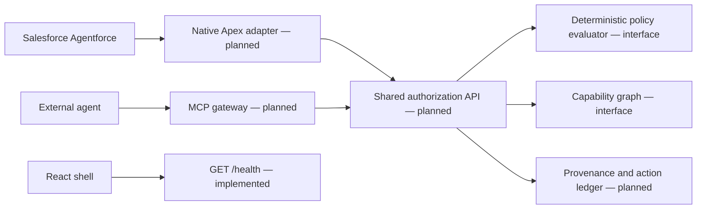

# Architecture and intended integration

AgentGuard is the repository/application name. CapabilityGraph is the proposed
authorization and graph subsystem. This bootstrap creates interfaces and local
development processes; the architecture below describes future connections.

The native Salesforce path and the MCP path must converge on the same decision
model and evaluator. Protocols in the Python packages establish those boundaries.
The backend does not expose `/v1/authorize` yet. The gateway does not mount `/mcp`.

## Module dependencies

All components depend on `packages/contracts`; the contracts package must never
import service implementations. The gateway should depend on an authorization
client interface rather than importing backend policy classes. Salesforce source
is deployed independently. The frontend should consume versioned JSON APIs and
schemas, not reproduce policy logic.

Python code is installed as one editable project during local development so
imports work without `PYTHONPATH` hacks. The directories still have distinct
ownership. Splitting them into separately released distributions is unnecessary
for the hackathon scaffold.

## Future request sequence

1. An adapter authenticates the caller and resolves its agent binding.
2. It validates untrusted action arguments into `AuthorizationRequest`.
3. The core resolves current permissions, provenance, and resource classification.
4. `PolicyEvaluator` evaluates the request with independently built `TrustedContext`.
5. Only a validated, current ALLOW could permit future protected execution.
6. A trusted adapter records the actual outcome separately from the policy decision.

These steps are design requirements, not currently working behavior. The only
concrete evaluator is `DenyAllPolicy`; the only gateway client is disabled.

## Graph semantics

`GraphBuilder` will transform `AgentCapabilities` into a `CapabilityGraph`.
Edges explicitly distinguish declared capability from observed evidence. Potential
paths are not records of exfiltration. No path detection or graph rendering is
included. NetworkX and React Flow are dependencies for the responsible teammates.

## State and deployment choices

No database or credential store is provisioned. Teammate 1 should choose an initial
ledger design in consultation with the adapters, then define migrations and event
integrity before adding persistence. Containers run the same health-only services
as native development and publish ports only on loopback.
