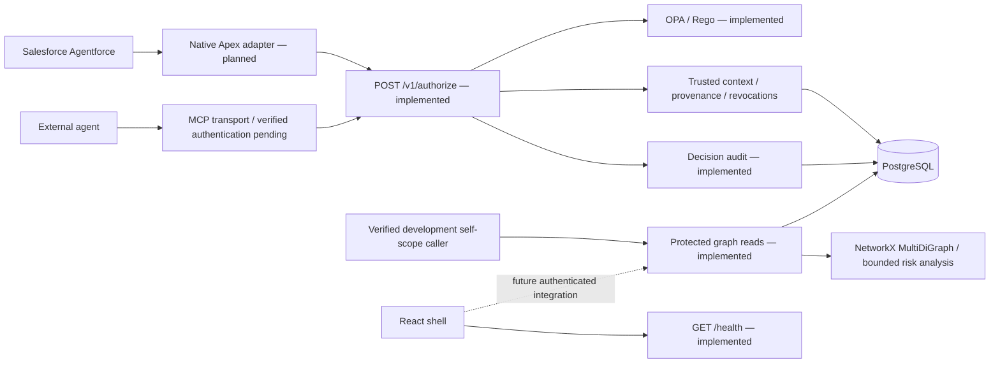

# Architecture and integration

AgentGuard is the repository/application name. The implemented central PDP uses
OPA/Rego plus file-backed or PostgreSQL trusted context. CapabilityGraph is a
separate read-only NetworkX analytical projection of PostgreSQL, not a policy
evaluator. MCP/Salesforce execution and the dashboard remain independent workstreams.

The native Salesforce path and the MCP path must converge on the same decision
model and evaluator. Protocols in the Python packages establish those boundaries.
The core exposes `/v1/authorize` and protected `/v1/capability-graph` and `/risks`
reads. The gateway mounts `/mcp` and preserves the archive demonstration and
optional downstream forwarder. Its transport passes no trusted caller identity,
so calls deny before authorization or execution. The HTTP client implements the
PDP correlation protocol without enabling caller authentication. The current
Rego does not allow `archive.local_demo`. Graph analysis never runs in the
authorization request path.

## Module dependencies

All components depend on `packages/contracts`; the contracts package must never
import service implementations. The gateway should depend on an authorization
client interface rather than importing backend policy classes. Salesforce source
is deployed independently. The frontend should consume versioned JSON APIs and
schemas, not reproduce policy logic.

Python code is installed as one editable project during local development so
imports work without `PYTHONPATH` hacks. The directories still have distinct
ownership. Splitting them into separately released distributions is unnecessary
for the hackathon scaffold.

## Authorization and future execution sequence

1. An adapter authenticates the caller and resolves its agent binding.
2. It validates untrusted action arguments into `AuthorizationRequest`.
3. The core resolves current permissions, provenance, and resource classification.
4. OPA evaluates the request with independently resolved trusted facts.
5. Only a validated, current ALLOW could permit future protected execution.
6. A trusted adapter records the actual outcome separately from the policy decision.

The core resolution, decision and PostgreSQL audit paths are implemented; guarded
execution and actual execution-event ingestion are not. Adapters must implement
the [correlation/expiry protocol](policy-pdp.md), not treat an ALLOW as execution.
The old `DenyAllPolicy` and disabled gateway client remain isolated scaffold interfaces.

## Graph semantics

`NetworkXGraphBuilder` projects an authenticated, bounded SQL snapshot. The
unpaired `AgentCapabilities` lists cannot ground action/resource mappings;
exact permission rows and explicit scoped tool data flows can. NetworkX provides
typed graph relationships, provenance SCC cycle checks and bounded lineage
traversal for potential confidential external-disclosure analysis. Historical
provenance remains after revocation; inactive/revoked grants cannot supply
current action edges. Missing facts make assessments incomplete, never safe.

Declared capabilities, observed provenance, authorization audit decisions and
execution outcomes are separate categories. No execution ledger exists, so no
finding establishes leakage. [CapabilityGraph](capabilitygraph.md) documents
metadata, traversal direction, new migration, API and dashboard handoff. React
Flow visualization is not implemented by this milestone.

## State and deployment choices

The optional Compose database profile provisions development PostgreSQL 16.
Alembic revisions 0001 (trusted PDP facts/audits) and 0002 (curated graph facts)
are applied explicitly; startup never migrates or imports fixtures. File-backed
PDP resolution remains available for isolated development; graph reads require
PostgreSQL and development self-scope bearer authentication. Production graph
reads are disabled pending graph-reader RBAC. Containers publish only loopback
ports; localhost and CORS alone are not authorization.
